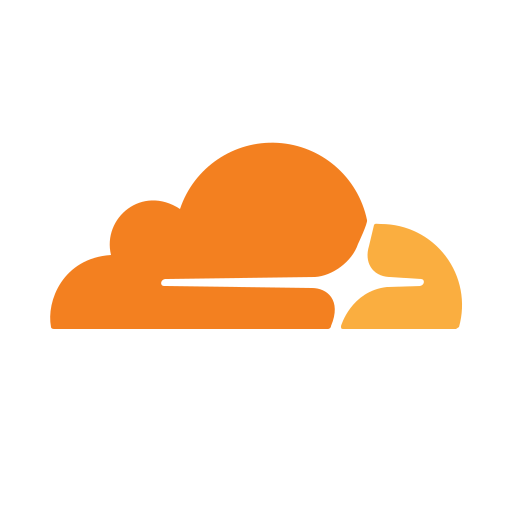

<p align="center">
  
</p>

# Cloudflare

**Fundamentos de Arquitectura de Software y Desarrollo de Backend**

Unidad II · Exposición: una herramienta de backend

---

## Equipo 2

- Carlos Llanes
- Michelle Cámara
- Euruviel Marquez
- Gael Magaña

## Tecnología elegida

**Cloudflare**: poner la API detrás de un proxy para tener HTTPS, caché y protección del servidor.

---

## Orden de la exposición

| #   | Apartado                 | Qué va en cada uno                                                                                                                                             |
| --- | ------------------------ | -------------------------------------------------------------------------------------------------------------------------------------------------------------- |
| 01  | El problema              | Una API publicada directo en internet está expuesta, sin cifrar y es lenta para usuarios lejanos.                                                              |
| 02  | Las piezas y cómo se usa | Dominio y DNS, red de Cloudflare, servidor de origen y panel de reglas. Configuración en 4 pasos.                                                              |
| 03  | Ejemplo                  | La API del curso detrás de Cloudflare: caché, límite de peticiones y token. Lo nuevo: Monetization Gateway con HTTP 402. Comparación con lo visto en el curso. |
| 04  | Ganancia y costo         | Qué gana el equipo, qué límites tiene y cuándo no conviene.                                                                                                    |
| 05  | Fuentes                  | Documentación oficial de Cloudflare.                                                                                                                           |

---

## 1. El problema que resuelve

- Si la API está publicada directo, **su IP real queda a la vista** y un ataque DDoS puede tumbarla.
- Sin HTTPS, **el token y los datos viajan sin cifrar** y se pueden leer en el camino.
- Hay un solo servidor, así que **los usuarios lejanos esperan más** en cada petición.
- **La idea:** Cloudflare se pone _delante_ de la API como proxy inverso. El usuario habla con Cloudflare y Cloudflare habla con la API.

## 2. Las piezas con las que se trabaja

- **Dominio y DNS:** los nameservers del dominio (por ejemplo `equipo.com`) pasan a Cloudflare.
- **Red de Cloudflare (el borde):** servidores en cientos de ciudades reciben la petición primero.
- **Servidor de origen:** la API de siempre, en Docker con MySQL. El código no cambia.
- **Panel y reglas:** desde la web se configuran SSL/TLS, caché, firewall y límite de peticiones.
- **`cloudflared` (opcional):** crea un túnel desde el servidor si este no tiene IP pública.

## 3. Cómo se usa, en pasos

1. Crear la cuenta y **agregar el dominio** en el panel de Cloudflare.
2. **Cambiar los nameservers** en el registrador por los dos que da Cloudflare.
3. En el registro DNS `api`, **activar la nube naranja** (_Proxied_). Desde ese momento el tráfico entra por Cloudflare.
4. **Configurar las reglas:**
   - SSL/TLS en modo **Full (strict)**;
   - una regla de caché para los GET públicos;
   - una regla de límite de peticiones para `/api/login`.
5. Sin IP pública, en lugar de los pasos 2 y 3 se usa `cloudflared tunnel` y no hay que abrir puertos.

## 4. En qué se parece o se diferencia de lo que ya vimos

| Lo que vimos         | Se parece                                    | Se diferencia                                                                                            |
| -------------------- | -------------------------------------------- | -------------------------------------------------------------------------------------------------------- |
| **Token y permisos** | Los dos deciden qué peticiones se aceptan.   | El token decide **quién** entra a la API. Cloudflare decide qué tráfico **llega** a la API.              |
| **Docker**           | Los dos ayudan a poner la API en producción. | Docker **corre** la API. Cloudflare solo se pone **delante** de ella.                                    |
| **MySQL**            | Los dos guardan datos para responder.        | MySQL guarda los datos reales. La caché de Cloudflare guarda **copias de respuestas** por unos segundos. |

**Conclusión:** son capas que se suman, no reemplazos. Cloudflare filtra, el token autoriza, Docker corre la API y MySQL guarda los datos.

## 5. Un ejemplo concreto

La API del curso se publica en `api.equipo.com` detrás de Cloudflare:

| Petición                                    | Qué pasa                                                                            | Resultado                      |
| ------------------------------------------- | ----------------------------------------------------------------------------------- | ------------------------------ |
| `GET /api/productos`                        | Una regla de caché guarda la lista 60 s en el borde. MySQL no recibe la consulta.   | `200` · `cf-cache-status: HIT` |
| `POST /api/login` (6.º intento en 1 minuto) | La regla de límite de peticiones lo frena antes de que llegue a la API.             | `429 Too Many Requests`        |
| `GET /api/usuarios/me` con token            | No se cachea. El header `Authorization` llega intacto y la API valida los permisos. | `200` desde el origen          |

Para comprobar que Cloudflare está delante:

```bash
curl -I https://api.equipo.com/api/productos
# HTTP/2 200
# server: cloudflare
# cf-cache-status: HIT
```

### Lo nuevo: Monetization Gateway (HTTP 402)

En septiembre de 2026, Cloudflare abrió en beta cerrada el **Monetization Gateway**. Con él, el mismo proxy que va delante de la API puede **cobrar por cada petición**, pensado sobre todo para agentes de IA.

1. Un agente pide un recurso sin haber pagado. Cloudflare responde **`402 Payment Required`** con el precio y a dónde pagar, sin página de checkout.
2. El agente firma el pago y repite la petición. Paga solo esa petición, sin cuenta, suscripción ni API key.
3. Cloudflare verifica el pago y deja pasar la petición a la API, que responde `200`.

- Las reglas de precio se definen por URL, headers o parámetros, igual que las reglas de caché o de límite.
- **Relación con el curso:**
  - el `402` es otro código de estado HTTP, como el `429` del ejemplo;
  - en lugar de un token o una API key, se cobra cada petición.
- **Límite:** está en beta cerrada, solo para EE. UU., y los pagos se hacen en USDC (una _stablecoin_). Por eso no lo usamos en la demo; lo presentamos como hacia dónde va la herramienta.

## 6. Qué gana el equipo y qué costo tiene

**Ganancia**

- HTTPS con certificado gratis y automático.
- La IP del servidor queda oculta.
- Protección DDoS incluida en el plan gratuito.
- Respuestas más rápidas gracias a la caché.

**Costo y límites**

- Hace falta un dominio propio.
- Cloudflare descifra el tráfico, así que es un tercero en el que hay que confiar.
- Si Cloudflare falla, la API no se ve.
- Las funciones avanzadas (WAF completo, más reglas) son de pago.

## 7. Cuándo no conviene usarla

- **API local o de práctica:** corre en el laboratorio o en `localhost` y nadie de afuera la usa.
- **Datos que no deben pasar por terceros:** hay reglas de privacidad que impiden que otra empresa vea el tráfico.
- **Sin dominio propio:** sin acceso a los nameservers no se puede activar el proxy.
- **Respuestas personales:** una regla de caché mal hecha en `/me` mostraría los datos de un usuario a otro.

## 8. Fuentes que vamos a consultar

1. Cloudflare Docs, _How Cloudflare works_: https://developers.cloudflare.com/fundamentals/concepts/how-cloudflare-works/
2. Cloudflare Docs, _Proxy status_: https://developers.cloudflare.com/dns/proxy-status/
3. Cloudflare Docs, _Encryption modes (SSL/TLS)_: https://developers.cloudflare.com/ssl/origin-configuration/ssl-modes/
4. Cloudflare Learning Center, _What is a reverse proxy?_: https://www.cloudflare.com/learning/cdn/glossary/reverse-proxy/
5. Cloudflare Blog, _Monetization Gateway beta: charge AI agents for consumption with HTTP 402_ (30 de septiembre de 2026): https://blog.cloudflare.com/monetization-gateway-beta/
